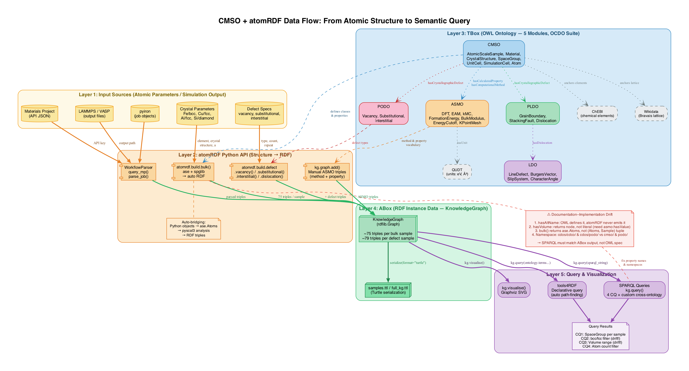

# cmso-repro

Reproduction of the **Computational Material Sample Ontology (CMSO)** and its companion ontologies
(ASMO, PLDO, PODO, LDO), using [atomRDF](https://github.com/pyscal/atomRDF) to generate RDF knowledge
graphs directly from atomic structures.

It is the companion to [mdo-repro](https://github.com/Daimian/mdo-repro): MDO maps existing data
to the ontology with hand-written SPARQL, while CMSO generates RDF from simulation structures in code.



## Contents

| Path | Content |
| --- | --- |
| [`CMSO_Reproduction_Handbook.md`](CMSO_Reproduction_Handbook.md) | step-by-step reproduction guide, in Chinese: environment, the five ontologies, atomRDF, the four official competency questions, defects, workflow parsing |
| `samples.ttl`, `my_samples.ttl`, `full_kg.ttl` | knowledge graphs generated during the reproduction |
| `visualize_cmso.py`, `visualize_dataflow.py` | scripts that draw the figures below |
| `cmso_*.png` / `.pdf` | class hierarchy, property map, per-module diagrams, data flow |

## Documentation drift

The handbook records where the ontology, the atomRDF docstrings and the generated graph disagree,
and how to work around each case: for example, `hasAltName` used by an official competency question
does not exist, and volume is a node, not a literal.

## Running the visualizations

The scripts expect the five ontology repositories cloned next to them (`cmso/`, `asmo/`, `pldo/`,
`podo/`, `ldo/`), as described in stage 0 of the handbook. Then:

```bash
pip install rdflib graphviz
python visualize_cmso.py
python visualize_dataflow.py
```

## License

[CC BY 4.0](LICENSE)
